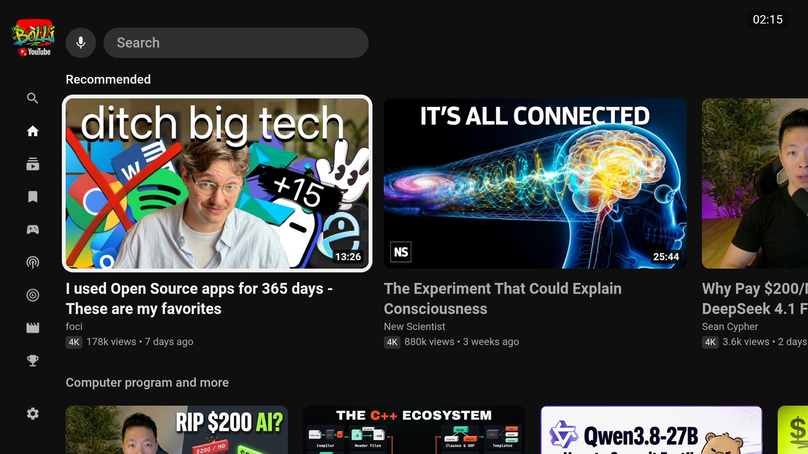
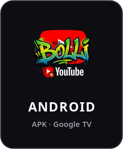
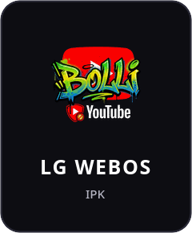

# Bolli YouTube

A YouTube app for LG webOS TVs, Android TV and Google TV. It looks and works like YouTube's own TV app, but it's fast on old TVs, has ad block and skips sponsor segments.

I made it for my own LG C7 from 2017 (webOS 3.9), where YouTube's app had gotten really slow.

Bolli YouTube is not made by or connected to YouTube or Google. You sign in with your own Google account.

<p align="center"></p>

<p align="center">
  <a href="https://github.com/aktiwers/bolli-youtube/releases/latest/download/bolli-youtube.apk"></a>
  &nbsp;&nbsp;
  <a href="https://github.com/aktiwers/bolli-youtube/releases/latest/download/bolli-youtube.ipk"></a>
</p>

<p align="center">Google TV and Android TV: enter the code <b>3023199</b> in the Downloader app, or open <a href="https://aftv.news/3023199">aftv.news/3023199</a> in a browser.</p>

<p align="center">LG webOS: add the Homebrew repository <code>https://aktiwers.github.io/bolli-homebrew/apps.json</code> in the Homebrew Channel (<a href="#lg-webos">see below</a>).</p>

## What it does

- Home, Subscriptions, Library, Gaming, Podcasts, Music, Movies and Sports, like YouTube's TV app
- Its own player: up to 4K (8K and AV1 on TVs that play them), live streams, chapters, subtitles (also auto-translated), dubbed audio tracks and stable volume
- Skips sponsors, intros and the like with [SponsorBlock](https://sponsor.ajay.app)
- YouTube's "Most replayed" graph over the progress bar
- Dislike counts are back, from [Return YouTube Dislike](https://returnyoutubedislike.com)
- Titles and thumbnails without clickbait from [DeArrow](https://dearrow.ajay.app), if you turn it on in Settings
- Ad block
- Previews when you rest on a video
- Search with YouTube's suggestions, and voice search on Android TV (the microphone, or the remote's search key)
- Cast from YouTube on your phone
- More than one account, with "Who's watching?"
- No Shorts

## Google TV and Android TV

1. Install **Downloader** (by AFTVnews) from Google Play.
2. Let Downloader install apps: Settings › Apps › Security & restrictions › Unknown sources › Downloader.
3. Open Downloader and enter the code **3023199**. The short link [aftv.news/3023199](https://aftv.news/3023199) or the full address
   `https://github.com/aktiwers/bolli-youtube/releases/latest/download/bolli-youtube.apk` does the same.
4. Install, and open **Bolli YouTube** under Your apps.

A new version installs the same way, over the old one. You stay signed in.

## LG webOS

For LG TVs with the webOS Homebrew Channel (rooted or in developer mode).

The easiest way is to add my Homebrew repository. Then Bolli YouTube is in the Homebrew Channel's list, and new versions show up there as updates:

1. Open the Homebrew Channel and go to Settings (the gear).
2. Choose **Add repository** and enter:

   ```
   https://aktiwers.github.io/bolli-homebrew/apps.json
   ```

3. Go back, and install Bolli YouTube from the list.

Or install the IPK directly:

```
https://github.com/aktiwers/bolli-youtube/releases/latest/download/bolli-youtube.ipk
```

## Cast from your phone

On older LG TVs, casting from the YouTube app on your phone goes straight to Bolli YouTube.

Newer LG TVs with Google Cast (2022 and later) send casts to LG's own YouTube app instead. There, link your phone once:

1. Open Bolli YouTube and go to Settings › Link with TV code.
2. In the YouTube app on your phone, tap the cast icon › Link with TV code, and enter the code.

After that, Bolli YouTube shows up in your phone's cast menu whenever it's open on the TV.

## Build it yourself

You need Node.js. The app is plain ES5 for the old Chrome 38 in webOS 3.x.

```
npm install
npm run build
```

That gives you the app in `apps/bolli-youtube`.

- **webOS:** `ares-package apps/bolli-youtube` with the webOS CLI, then install the IPK with the Homebrew Channel or `ares-install`.
- **Android:** copy the app into the Android project and build it with Gradle:

  ```
  mkdir -p android/app/src/main/assets
  cp -r apps/bolli-youtube/* android/app/src/main/assets/
  sed -i 's|<meta charset="utf-8">|&\n<meta name="viewport" content="width=1280, user-scalable=no">|' android/app/src/main/assets/index.html
  cd android && ./gradlew assembleDebug
  ```

## Thanks

- [YouTube AdFree](https://github.com/webosbrew/youtube-webos) (GPL-3.0): how to hook into YouTube's TV app, and its ad filters, I learned from it.
- [SponsorBlock](https://sponsor.ajay.app): the segments its users mark.
- [DeArrow](https://dearrow.ajay.app): the titles and thumbnails its users submit (CC BY-NC-SA 4.0). Its logo is based on [Twemoji](https://github.com/twitter/twemoji) (CC-BY 4.0).
- [Return YouTube Dislike](https://returnyoutubedislike.com): the dislike counts.
- [yt-dlp](https://github.com/yt-dlp/yt-dlp) and [NewPipe](https://github.com/TeamNewPipe/NewPipeExtractor): the YouTube client the player asks for streams.
- Fonts: Roboto (Apache 2.0) and Inter (SIL Open Font License). QR codes: [QR Code Generator](https://github.com/kazuhikoarase/qrcode-generator) by Kazuhiko Arase (MIT).

## License

GPL-3.0, see [LICENSE](LICENSE).
